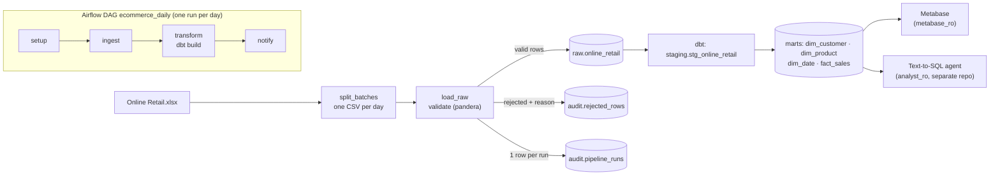
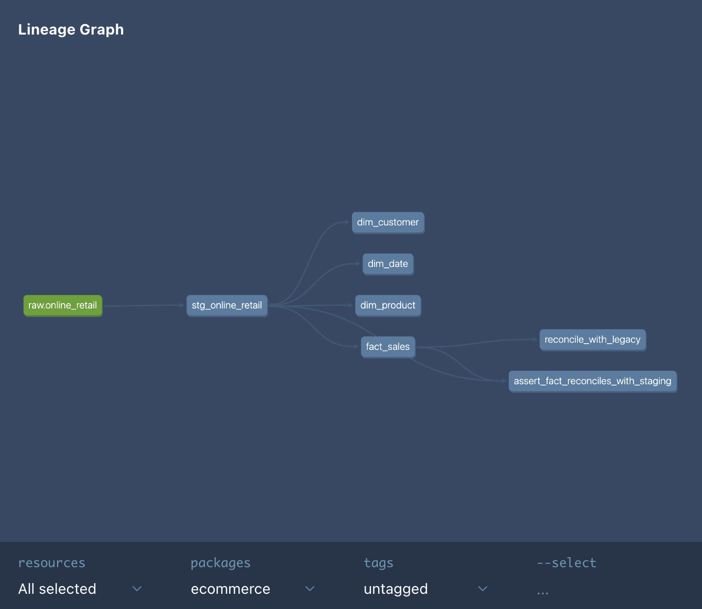
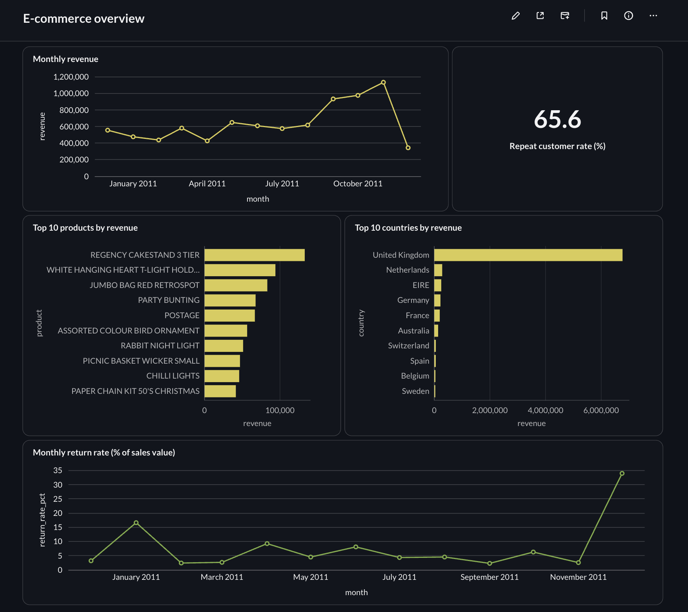

# E-commerce Data Pipeline

[](https://github.com/White481/e-commerce-data-pipeline/actions/workflows/ci.yml)

A daily batch pipeline for the UCI Online Retail dataset (541,909 invoice lines, Dec 2010 – Dec 2011):
validated, idempotent loads into Postgres, a dbt star schema, Airflow orchestration with backfills,
CI against a real database, and a Metabase dashboard on a read-only role. Everything runs locally
with Docker.

A separate project, **[e-commerce-ai-agent](https://github.com/White481/e-commerce-ai-agent)**,
answers Thai/English questions over the same `marts` tables with an LLM, through its own read-only role.

**Stack:** Python 3.12/3.14 · pandas · pandera · PostgreSQL 16 · dbt 1.12 · Airflow 3.3 · Metabase 0.64 · Docker Compose · GitHub Actions

## 1. Results at a glance

| | |
|---|---|
| Raw rows processed | 541,909 invoice lines, 25,900 invoices |
| Rejected by validation | 2,517 rows (0.46%), each with a reason in `audit.rejected_rows` |
| Loaded | 539,392 rows — identical whether loaded in one shot or as 305 daily files |
| Re-run the same day | 0 rows inserted, 0 updated (idempotent) |
| Airflow backfill | January 2011, 31/31 runs green; a forced mid-run failure left no duplicates |
| dbt | 5 models, 24 tests + a reconciliation test, all passing |
| Tests | 37 pytest tests (unit + DB integration), run in CI on every PR |
| Dashboard | 5 charts on `marts`, read through a `SELECT`-only role |

## 2. Architecture



| Layer | Schema | Built by | Purpose |
|---|---|---|---|
| Raw | `raw` | `ingest/load_raw.py` | Source rows that passed validation, keyed by `line_id` |
| Audit | `audit` | `ingest/load_raw.py` | Every run (`pipeline_runs`) and every rejected row with its reason |
| Staging | `staging` | dbt (view) | Typed, renamed columns + derived `total_amount`, `is_return` |
| Marts | `marts` | dbt (tables) | Star schema for analysis and BI |

## 3. Data model

**Grain of `fact_sales`: one invoice line with a known customer.** `(invoice_no, stock_code)` is
*not* unique — 9,694 pairs repeat, up to 20 times in one invoice — so each line gets
`line_id = <invoice_no>-<line_no>`, its position inside the invoice.

| Table | Key | Rows | Notes |
|---|---|---|---|
| `fact_sales` | `line_id` | 406,789 | incremental, replaced one day at a time (`delete+insert` on `date_key`) |
| `dim_customer` | `customer_id` | 4,371 | first country seen per customer |
| `dim_product` | `product_key = md5(stock_code)` | 3,938 | stable key across full rebuilds |
| `dim_date` | `date_key` | 305 | year, month, day, weekday |



## 4. How it works

**Ingest + validate** (`ingest/load_raw.py`, `ingest/validate.py`). Each batch is validated with
pandera: `unit_price <= 0`, cancelled invoice (`C…`) with positive quantity, null date, duplicate
`line_id`. Bad rows go to `audit.rejected_rows`; good rows are COPY'd into a temp table and merged
with `INSERT … ON CONFLICT (line_id)` in **one transaction**, so a failed load changes nothing.
A **circuit breaker** stops the whole batch if more than 5% is rejected.

**Incremental loading** (`ingest/run.py`). `load --date YYYY-MM-DD` loads one daily file and
replaces that day; a day without a file is recorded as `skipped` and exits 0. `load --since-last`
starts from the **watermark** (the latest day that actually has rows) and re-loads that day too, or
from the first gap if an out-of-order load left one.

**Transform** (`dbt_project/`). Staging view → star schema. Tests cover keys (`unique`,
`not_null`), every fact→dim `relationship`, `accepted_values`, and a singular test that each day in
the fact matches staging on row count and revenue.

**Orchestrate** (`dags/ecommerce_daily.py`). Airflow 3.3.2 runs `setup → ingest → transform →
notify` per day with `catchup=True`, `retries=2`, `max_active_runs=1`. Every task is idempotent,
so retries, clears and backfills never duplicate data.


**Serve** (`ingest/roles.py`, `metabase/setup_dashboard.py`). Metabase reads `marts` as
`metabase_ro` (no access to `raw`/`audit`/`staging`, no writes). The dashboard is created through
the Metabase API, so it is reproducible instead of hand-clicked. The
[Text-to-SQL agent](https://github.com/White481/e-commerce-ai-agent) is a second consumer of
`marts`, with its own `analyst_ro` role.



- **Repeat customers:** 65.6% of customers ordered more than once.
- **Top product:** REGENCY CAKESTAND 3 TIER (132,870.40). **Top market:** United Kingdom (6.77M, 81.5% of customer revenue).
- **Return-rate spikes are single orders, not trends:** on 2011-01-18 and 2011-12-09 one customer
  ordered and cancelled 74,215 and 80,995 units the same day. December 2011 also stops on the 9th.

## 5. Design decisions

| Decision | Why | Trade-off |
|---|---|---|
| Upsert by `line_id` inside one transaction | Re-runs and retries are safe; partial loads are impossible | Needs a stable line id (see Limitations) |
| A daily file replaces its whole day | Rows removed or newly rejected at the source disappear too, not only new rows added | One day is the smallest unit of reload |
| Missing `CustomerID` is **not** a validation rule | 24.9% of rows are guest checkouts — real revenue. As a rule it would trip the 5% breaker on every batch | `fact_sales` (and the dashboard) covers customer sales only; guest sales, 15% of revenue, are in staging |
| Circuit breaker with *reviewed* overrides | Stops a broken export, but 2 real days exceed 5% (zero-price stock adjustments) | An approved rate is stored in audit and reused, so a reviewed day isn't blocked again |
| Watermark from the data, not the audit log | Deleted data is reloaded automatically | Needs the gap check so out-of-order loads can't skip days |
| dbt incremental `delete+insert` per day | Same semantics as the loader, so Airflow retries stay idempotent | Dims are full rebuilds (cheap at this size) |
| Pipeline deps in their own venv inside the Airflow image | pandas 3 / SQLAlchemy 2 don't collide with Airflow's pins | Two Python environments in one image |
| One read-only role per consumer (`metabase_ro`) | Least privilege; one consumer's credentials can't break another | More roles to manage |

**Reconciliation against the original v1 tables** (`public.*`, built by `clean_data.py` before this
rework): revenue is identical at 8,300,065.81. The fact has 40 fewer rows (zero-price lines now
rejected), `dim_customer` loses one customer who only had zero-price lines, and `dim_product` gains
254 products sold only to guests.

## 6. What I ran into

Full log with numbers: [NOTES.md](NOTES.md). The ones worth knowing:

- **The watermark skipped 22 days.** After `--since-last` stopped at a circuit-breaker day, I
  loaded a later day by hand; the data-based watermark jumped past the gap and 32,781 rows were
  never loaded. Fixed with a gap check, then reconciled: 539,392 rows, revenue 9,769,872.05.
- **An approved override wasn't remembered.** `--since-last` re-loads the watermark day, so a
  reviewed high-reject day tripped the breaker on every run and the pipeline was stuck.
- **Airflow 3 changed the defaults.** `@daily` now gives a zero-length interval (switched to
  `CronDataIntervalTimetable` so `{{ ds }}` is the processed day), backfills only run on *unpaused*
  DAGs, and the UI's "reprocess completed" re-queued 28 green runs. Idempotent tasks made all of it
  harmless.
- **A test changed another project's password.** Postgres roles are server-wide; the roadmap's
  `analyst_ro` already belonged to my [Text-to-SQL agent](https://github.com/White481/e-commerce-ai-agent). Restored it, renamed the BI role, and the
  test now uses a throwaway role.
- **Upsert never deletes.** Rows loaded before validation existed stayed in raw until the load also
  removed rejected and vanished rows for the day.
- **The DB password was in git history.** Moving it to `.env` doesn't remove old commits, so it was
  rotated.

## 7. Limitations and next steps

- `line_id` depends on row order in the source file. A re-export in a different order would shift
  ids; a real source system should provide a line id.
- 5,268 rows are exact duplicates of another row. They are kept (they could be real repeat scans);
  the source can't tell us which.
- Single machine, local Docker, simple-auth Airflow and a no-login Airflow UI: fine for a demo,
  not for production. Next would be managed Postgres, secrets in a vault, and alerting from `notify`.
- Dimensions are rebuilt in full each run and customer country is "first seen" (no SCD history).
- The dataset ends on 2011-12-09, so December 2011 is a partial month in every chart.

## 8. Run it locally

Requires Docker and Python 3.11+.

```bash
cp .env.example .env               # fill in the passwords
python3 -m venv venv && source venv/bin/activate
pip install -r requirements.txt

make up                            # Postgres
make split                         # data/landing/YYYY-MM-DD.csv
make load-since-last               # validate + load every day; stops at a day over the 5% breaker
make dbt-build                     # staging + marts + tests
make test && make lint

make airflow-up                    # http://localhost:8080 — DAG starts paused
make backfill FROM=2011-01-01 TO=2011-01-31

make roles && make metabase-up     # http://localhost:3000
make metabase-setup                # admin, connection, charts, dashboard
make dbt-docs                      # lineage graph at http://localhost:8081
```

Two real days exceed the breaker (2010-12-22 and 2011-01-28). After reviewing their rejected rows,
load them with `python -m ingest.run load --date 2010-12-22 --max-reject-rate 0.25` (and `0.06`
for 2011-01-28), then run `make load-since-last` again.

The v1 pipeline (`make create-tables && make clean-data && make load`) is kept for the
reconciliation above; `analyses/analysis_queries.sql` runs against either schema
(`SET search_path = marts;` for the dbt tables).

## 9. Repository layout

```
ingest/           load_raw, validate, run (CLI), split_batches, roles, db
sql/init.sql      raw + audit schemas
dbt_project/      staging and marts models, tests, profiles.yml (env-based)
dags/             Airflow DAG
airflow/          Airflow image (pipeline venv) + metadata DB init
metabase/         dashboard-as-code via the Metabase API
tests/            pytest: validation, idempotency, incremental, roles
.github/workflows CI: lint, tests, real-data load, dbt build, role check
docs/             screenshots, roadmap checklist
NOTES.md          everything that went wrong, with numbers
```
