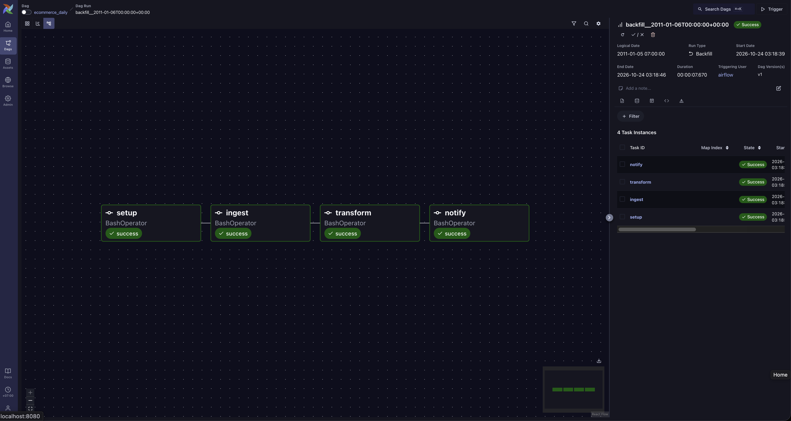

**Stack:** Python, pandas, PostgreSQL 16, Docker, SQLAlchemy, SQL

## Data Model (Star Schema)

- `fact_sales` — central table storing every transaction
- `dim_customer` — customer info + country
- `dim_product` — product details
- `dim_date` — calendar table, broken down by year/month/day/weekday

A star schema was chosen because it's the standard data warehouse pattern 
that makes business analysis queries (revenue, top products) fast and easy to read.

## Data Quality Decisions

While cleansing the data, I found two issues that required a deliberate decision on how to handle them:

1. **CustomerID missing in ~25% of rows** — decided to drop these rows, since per-customer 
   analysis isn't possible without knowing who made the purchase. Hypothesis: the point-of-sale 
   system may allow guest checkout without requiring login.
2. **Negative Quantity values (~10,600 rows)** — not an error, but **product returns**. 
   Kept these rows and added an `is_return` flag column instead of discarding them, 
   so return volume can still be analyzed separately.

## Validation Rules (Phase 2)

`ingest/validate.py` (pandera) runs before every load. Failing rows are **not** loaded;
they go to `audit.rejected_rows` with a reason, and each run prints how many rows were
read / rejected / loaded.

| Rule | Rows rejected (full file) |
|---|---|
| `unit_price <= 0` | 2,517 (0.46%) |
| cancelled invoice (`C…`) with positive quantity | 0 |
| `invoice_date` is null | 0 |
| duplicate `line_id` | 0 |

**Circuit breaker:** if more than 5% of a batch is rejected, the whole batch is stopped
(nothing is loaded, the run is marked `failed`). That much bad data usually means a broken
export, not a few bad rows.

**Why missing `CustomerID` is not a validation rule:** it affects 24.9% of rows, so it would
trip the circuit breaker on every batch. More importantly, it isn't invalid data — those are
real sales (likely guest checkout) and they still count toward revenue and product totals.
The raw layer keeps them; the per-customer filter stays in `clean_data.py` (and will move to
the fact model in dbt), where it's a modelling choice rather than a data-quality failure.

## Incremental Loading (Phase 3)

- Each daily file is the full truth for that day: the load upserts by `line_id`, then deletes
  that day's rows that are no longer in the file (rejected now, or removed at the source).
- **Watermark** = latest day that actually has rows in `raw.online_retail` (not what the audit
  log says ran), so deleted data is reloaded automatically. `--since-last` starts at the
  watermark day — or at the first day that has a landing file but no rows, if that is earlier —
  so an out-of-order load can't leave a gap.
- **Reviewed overrides:** two real days exceed the 5% circuit breaker (2010-12-22: 22.0%,
  2011-01-28: 5.1% — zero-price stock adjustments). After checking them, they were loaded with
  `--max-reject-rate`. The approved rate is stored in `audit.pipeline_runs` and reused when
  that day is reloaded, so the breaker doesn't block the same reviewed day again.
- Loading all 305 daily files gives exactly the same result as the one-shot load:
  539,392 rows, revenue 9,769,872.05.

## Orchestration (Phase 5)

`dags/ecommerce_daily.py` (Airflow 3.3.2, standalone in `docker-compose.yml`) runs one day per DAG run:

```
setup → ingest → transform → notify
```

| Task | Command | Why it's safe to retry |
|---|---|---|
| setup | `ingest.run init` | `CREATE ... IF NOT EXISTS` only |
| ingest | `ingest.run load --date {{ ds }}` | upsert by `line_id` + replace that day; no file → `skipped`, exit 0 |
| transform | `ingest.run transform --date {{ ds }}` | one transaction: dims `ON CONFLICT DO NOTHING`, fact rows of that day deleted and re-inserted |
| notify | `ingest.run notify --date {{ ds }}` | read-only summary in the task log |

`catchup=True`, `retries=2`, `max_active_runs=1`, classic daily data intervals
(`CronDataIntervalTimetable`) so the run with logical date 2011-01-05 processes 2011-01-05.
Pipeline dependencies live in a separate venv inside the image (`/opt/pipeline-venv`) so pandas 3 /
SQLAlchemy 2 don't fight Airflow's own pins. Reviewed circuit-breaker overrides can be passed as
run conf: `{"max_reject_rate": 0.25}`.

**Proof (January 2011 backfill):** 31/31 runs green; January raw rows deleted beforehand were
reloaded (35,007); days without a file were `skipped` and stayed green. Mart vs raw for every
processed day: rows and revenue match, 0 duplicate `line_id`s. Failure test: forced `transform`
for 2011-01-05 to fail after writing (all 3 tries failed, rolled back), removed the flag, cleared
the task — the day still has exactly 1,117 fact rows / 28,150.40 before, after the failure, and
after the re-run.



## Setup

Requires Python 3.11+ (pandas 3.x) and Docker.

```bash
# 0. Configure credentials (never commit .env)
cp .env.example .env          # then edit the values
python3 -m venv venv && source venv/bin/activate
pip install -r requirements.txt

# 1. Start Postgres
make up

# 2. Create tables
make create-tables

# 3. Clean the raw data
make clean-data

# 4. Load into Postgres
make load

# Raw layer with validation + audit (Phase 1–2)
make init-db
make load-raw

# Incremental daily loads (Phase 3)
make split                      # data/landing/YYYY-MM-DD.csv, one file per day
make load-day DATE=2011-01-05   # one day; a missing file is recorded as "skipped"
make load-since-last            # catch up from the watermark (re-loads the watermark day)

# Airflow (Phase 5) — UI at http://localhost:8080 (local only, no login)
make airflow-up
make backfill FROM=2011-01-01 TO=2011-01-31

# 5. Business analysis queries: see analyses/analysis_queries.sql
```

Run the unit tests and linter with `make test` and `make lint`.

> `make load` appends, so re-running it on a populated database fails on primary keys.
> To start fresh: `docker compose down -v && make up && make create-tables && make load`.

## Business Insights

Full queries available in `analyses/analysis_queries.sql`, covering:
- Monthly revenue trend
- Top 10 best-selling products
- Top 10 customers by spend
- Monthly return volume

## Lessons Learned

- A Docker volume only sets the password at first creation — editing `docker-compose.yml` 
  afterward has no effect if the volume already exists. Requires `docker compose down -v` to recreate.
- `pandas.to_sql(if_exists="append")` will auto-create a table if it doesn't exist yet — 
  this is risky because the table won't have the intended constraints (PK/FK). Schema management 
  (SQL DDL) should be kept clearly separate from data loading (Python).